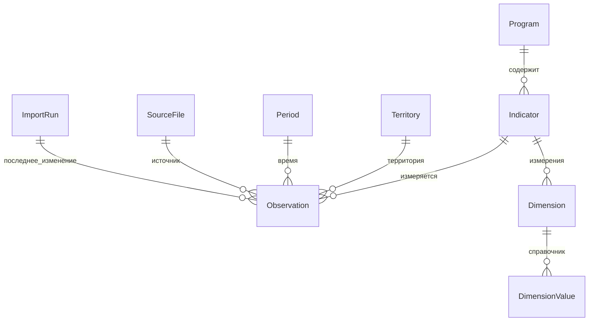

# Архитектура и модель данных

Приложение использует Django 5.2 и SQLite. Python обрабатывает импорт и запросы. Шаблоны формируют HTML, Bootstrap обеспечивает базовые формы и адаптивность, Chart.js рисует графики из той же выборки. Все frontend-файлы хранятся локально. Отдельного frontend-сервера нет.

## Структура

`config/settings.py` задаёт SQLite, русскую локаль, loopback-хосты и лимиты HTTP. `catalog.py` хранит две программы и явное сопоставление шести файлов. `sdmx.py` разбирает ZIP и XML в промежуточные документы. `importer.py` выполняет транзакционный upsert. `queries.py` формирует единую выборку и данные графиков. `views.py` обслуживает паспорта, фильтры, загрузчик, CSV, JSON и историю. `models.py` содержит ограничения и индексы. `management/commands` обеспечивает воспроизводимый импорт и исследование. `tests.py` проверяет исходные данные и пользовательские сценарии.

## Схема БД

| Сущность | Назначение и ключи |
| --- | --- |
| Program | Уникальный slug, название, смысл, исторические сроки и официальные ссылки |
| Indicator | Программа, уникальный file_id, отдельный metadata_id из Indicator/@id, название, единица и метаданные |
| Territory | Уникальный строковый code, исходное название, уровень территории |
| Period | Уникальный code: год либо год и квартал, подпись, год, хронологический ключ сортировки |
| Observation | FK на показатель, территорию, период, источник и импорт; точное число, исходный текст, размеры, атрибуты и статусы |
| Dimension | Уникальная пара indicator/code, роль ключа либо значимого атрибута |
| DimensionValue | Уникальная пара dimension/code и расшифровка справочника |
| SourceFile | Уникальный SHA-256, исходное имя, путь сохранённой копии, размер, отдельные Header/ID и DataSetID, дата выгрузки, метаданные |
| ImportRun | Время, статус, файлы, число добавлений/обновлений/пропусков/ошибок и подробности по файлам |

Наблюдение имеет уникальный ключ `(indicator, territory, period, dimension_key)`. Последнее поле — SHA-256 канонического JSON всех дополнительных ключей SeriesKey и значимых атрибутов EI, PERIOD, UNIT_MULT, DECIMALS, FREQ. Хранятся также сам JSON и расшифровки. Для исходных данных это сохраняет ОКФС, единицы и тип периода, предотвращает слияние кварталов. При одинаковом ключе обновляются значение, исходный текст, атрибуты, статусы и ссылки на последнее изменившее их происхождение. Полностью одинаковая запись пропускается. Отсутствующие в новом файле старые записи не удаляются.

Индексы `(indicator, period, territory)` и `(territory, period)` ускоряют отбор. FK PROTECT защищает источники, периоды и территории от удаления при наличии наблюдений. Числа хранятся в TEXT, чтобы SQLite NUMERIC не переводил Decimal в двоичный float; преобразование в Decimal происходит в Python, сортировка чисел также выполняется в Python. Исходное значение с запятой сохраняется отдельно.

## Поддерживаемый SDMX

- Корень `{http://www.SDMX.org/resources/SDMXML/schemas/v1_0/message}GenericData`.
- Header с ID, DataSetID и Prepared, CodeLists из пространства `structure`, Description/Indicator с встроенной методикой.
- DataSet/Series с SeriesKey, Attributes, Obs/Time и ObsValue. Учитываются атрибуты набора, ряда и наблюдения, последние переопределяют предыдущие.
- Территория определяется по s_OKATO, прочие ключи сохраняются и фильтруются. Статусы из атрибутов и дополнительных атрибутов ObsValue сохраняются в JSON.
- Поддержаны годы YYYY и YYYY-Q1…Q4. В предоставленном 44198 сочетание Time=2014 и PERIOD=I квартал даёт Period.code=2014-Q1. Исходный PERIOD остаётся видимым измерением. Неизвестные семантические атрибуты сохраняются, но не включаются автоматически в ключ: при появлении нового формата нужно исследовать их смысл. Конфликтующие дубликаты внутри файла отклоняются.
- Десятичная запятая нормализуется в точку, пробелы-разделители удаляются только при разборе числа. Пустые и специальные значения остаются в raw_value, numeric_text=NULL, исходные статусы сохраняются. NaN и бесконечности не становятся числом.
- Множитель UNIT_MULT сохраняется, автоматического перемасштабирования нет. Словесная единица EI уже может содержать масштаб.

## Безопасность файлов и транзакции

Архивы читаются в памяти без извлечения на диск. Нормализуются разделители, отклоняются абсолютные пути, `..`, двоеточия и NUL. У имён без флага UTF-8 восстанавливается CP866 из исходной CP437-интерпретации. Зашифрованные ZIP не поддерживаются. Лимиты: 20 МБ суммарной загрузки, 15 МБ на XML или элемент ZIP, 80 МБ суммарного распакованного объёма с учётом вложенных ZIP, глубина 3, не более 100 элементов. ZIP и содержимое XML проверяются независимо от расширения. defusedxml запрещает DTD, внешние и внутренние сущности.

Предпросмотр хранится на сервере в data/staging под случайным UUID, привязанным к сессии. Срок жизни один час. При подтверждении проверяются программы и SHA-256, одноразовый файловый lock предотвращает повторную обработку. CSRF проверяется Django. В случае неудачного импорта нужен новый предпросмотр. Старые staging-папки можно удалять при остановленном сервере; они не входят в сдаваемый комплект.

Весь подтверждённый пакет импортируется в одной `transaction.atomic()`. Ошибка откатывает изменения базы целиком, а ImportRun вне транзакции сохраняет сообщение. Файловые копии источников не транзакционны: при сбое может остаться неиспользуемый файл с именем SHA-256. Он не создаёт наблюдений и не меняет статистику. История хранит агрегаты по пакету и файлам, но не полную историю прежних значений каждого наблюдения.

## Запросы и графики

Один сервис `select_rows` использует одну программу, выбранный режим и все фильтры. HTML показывает 50 строк на странице, CSV и JSON возвращают все строки. Диаграммы строятся по всему результату. Разные показатели и разные единицы не складываются. Временные пробелы дают null. Линейный график различает комбинации дополнительных измерений, столбцы выбирают один период из той же выборки, тепловая карта требует однозначную клетку. При неоднозначности или слишком большом количестве рядов выводится объяснение.

Предел 12 рядов предотвращает нечитаемую легенду. Для тепловой карты дополнительно установлен предел 50 территорий и 30 периодов. Сервис не выполняет агрегации округов, субъектов и городов. Территории классифицируются по кодам и названиям предоставленного справочника, не рассматриваются как полный актуальный административный реестр.
