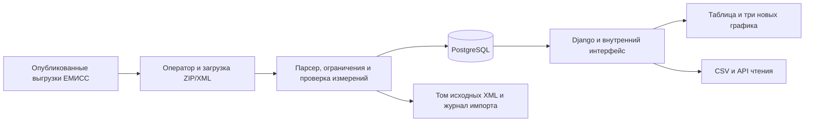

# Предложение пилотного внедрения в организацию типа Мосстата

Статус: **предложение для обсуждения**, не описание состоявшегося внедрения. Реализован учебный внутренний аналитический модуль на опубликованных агрегированных данных. Контактов с Мосстатом, доступа к его внутренним системам и согласованного проекта внедрения нет.

## Подтверждённые публичные сведения

Проверено 7 ноября 2026 года по официальным публичным источникам. Сайты Росстата не всегда отдавали страницы напрямую в используемой среде; для приведённых утверждений доступны индексированные тексты официальных страниц. Они не раскрывают внутреннюю архитектуру или порядок корпоративной авторизации.

- Мосстат — Управление Федеральной службы государственной статистики по г. Москве и Московской области, межрегиональный территориальный орган Росстата, действующий в Москве и Московской области. Официальная страница описывает сбор и обработку статистических и административных данных и предоставление официальной статистической информации. [Мосстат: «О Мосстате»](https://77.rosstat.gov.ru/about), [Росстат: территориальные органы](https://www.rosstat.gov.ru/territorial).
- Росстат описывает ЕМИСС как средство открытого бесплатного доступа к официальным статистическим показателям и метаданным. Паспорт показателя содержит сведения о временном ряде, обновлении, признаках и формах наблюдения. На странице указан доступ через веб-портал и поиск. [Росстат: показатели и метаданные ЕМИСС](https://www.rosstat.gov.ru/folder/13390?print=1).
- Официальный территориальный сайт указывает создание и ввод ЕМИСС в эксплуатацию в соответствии с постановлением Правительства РФ от 26.05.2010 № 367. Здесь это справочная ссылка на публичное описание, а не юридическое заключение о действующей редакции. [Официальная страница ЕМИСС](https://02.rosstat.gov.ru/emiss).

Отсюда следует только возможность обсуждать модуль анализа опубликованных показателей. Эти источники не подтверждают наличие у Мосстата открытого API загрузки, согласованного корпоративного SSO, контейнерной платформы или потребности в конкретной реализации. Такие утверждения в проекте не делаются.

## Задача пилота и границы данных

Предлагается дать небольшой группе операторов и аналитиков воспроизводимый способ загрузить выгрузку ЕМИСС, проверить её состав, выбрать сопоставимые территории и периоды и подготовить график/CSV для аналитической записки. Начальный объём — две исторические государственные программы, 6 показателей и 6 792 наблюдения из предоставленного архива. Это демонстрационный набор, а не действующая ведомственная информационная база.

Пилот работает только с уже опубликованными агрегированными значениями. Приём первичных сведений респондентов, персональных данных, закрытых статистических сведений и замена ведомственных систем в объём предложения не входят. Добавление таких данных потребует другого согласования источников, режима доступа и размещения.

## Пользователи и реализованное разграничение

| Роль | Задачи пилота | Реализация |
| --- | --- | --- |
| Аналитик | Читать паспорта, фильтровать наблюдения, строить графики, экспортировать CSV и читать API | Права `view_*` приложения monitor; обязательное `monitor.view_observation` для просмотра |
| Оператор загрузки | Действия аналитика, проверка файлов, предпросмотр, подтверждение импорта | Права чтения и `monitor.add_importrun` |
| Администратор | Учётные записи, группы, метаданные, сопровождение данных и разрешение ошибок | Права monitor/auth; доступ к Django admin требует `is_staff`; технический суперпользователь создаётся отдельно |

Команда `setup_roles` создаёт и обновляет группы, но не содержит стандартных паролей и не создаёт пользователей. Администратор заводит пользователей и назначает группы. Реализация использует Django authentication/permissions и сессии. Для POST действует CSRF-защита. Пользователь без права загрузки получает отказ даже при прямом обращении к форме; скрытая кнопка сама по себе не является защитой. API без входа отвечает 401, без права чтения — 403.

Корпоративная авторизация, жизненный цикл учётных записей сотрудников, MFA, блокировки и журнал доступа согласуются отдельно. Нельзя считать Django-сессии готовым подключением к ведомственному каталогу пользователей.

## Поток данных и границы обмена

Базовый пользовательский сценарий:

1. Оператор получает опубликованную выгрузку и входит в приложение.
2. Загружает ZIP/SDMX/XML; парсер проверяет формат, безопасную распаковку, идентификаторы, периоды и ключи наблюдений. Оператор видит предпросмотр, состав показателей и предупреждения об неизвестных кодах.
3. Подтверждает загрузку. БД обновляется транзакционно; одинаковые строки пропускаются, изменённые значения и статусы обновляются. Исходники хранятся по SHA-256. История содержит исполнителя и счётчики результата.
4. Аналитик задаёт показатель, территории одного уровня, периоды, единицу и ОКФС при наличии. Видит те же строки в таблице, экспорте и наборах данных графиков.
5. Строит подходящий график, проверяет подписи/исключения, экспортирует изображение или CSV и указывает источник, период, единицу и ограничения в отчёте.

Реализованные интерфейсы: защищённая форма загрузки файлов, CLI `import_sdmx`, CSV всей отфильтрованной выборки, JSON API чтения показателей и наблюдений с пагинацией и метаданными источника. Контракт описан в `docs/api.md`. Автоматическое получение выгрузок по расписанию и вызовы предполагаемого API ЕМИСС не реализованы; импорт начинается с фактически полученного файла.

## Предлагаемое размещение

Один согласованный внутренний сервер с Docker Compose достаточен для начального пилота. Конфигурация проекта разделяет сервис приложения Gunicorn/Django и PostgreSQL; одноразовый сервис миграций должен успешно завершиться до обслуживания запросов. Статика собирается при сборке и выдаётся приложением через WhiteNoise. Отдельный прокси для локальной демонстрации не требуется.

БД доступна только по имени сервиса `db` во внутренней сети Compose, без публикации порта хосту. PostgreSQL использует именованный постоянный том, XML и файлы предпросмотра — отдельный том. Учётная запись приложения отличается от административной учётной записи БД. Процесс приложения работает без root. Пароли и ключ Django задаются через окружение и не включаются в образ/репозиторий.

Для внутренней сети организации предлагается подключить приложение к принятому TLS-прокси и системе мониторинга. Конкретный продукт, сертификаты, DNS, межсетевые правила, путь хранения резервных копий и доверие заголовкам прокси должны определить ИТ-специалисты принимающей организации. Они не выводятся из публичного сайта Мосстата. При переключении на HTTPS включаются защищённые cookie и соответствующие настройки CSRF/хоста.

## Загрузки, ошибки и происхождение

В БД сохраняются ImportRun: время, оператор (для новых web-загрузок), статус, список файлов, число добавленных/обновлённых/пропущенных строк, ошибки и детализация по источникам. У старых импортов и CLI-операций без пользователя исполнитель может отсутствовать: это обозначается явно. SourceFile хранит SHA-256, исходное имя, Header/ID, DataSetID и метаданные XML; каждое наблюдение связано с источником и последним изменившим его импортом.

Ошибки парсинга/небезопасного архива отклоняются; неуспешный импорт не оставляет частично обновлённые наблюдения. Неизвестный код ОКФС сохраняется с диагностикой, а не заменяется итоговым кодом. Приложение и сервер запросов пишут сообщения в стандартные потоки контейнеров. Для пилота следует согласовать сбор этих потоков, срок хранения, уведомления о сбоях и ограничение доступа к журналам. Это не неизменяемый ведомственный аудит, не полная история всех просмотров и не система расследования действий пользователей.

## Резервирование, обновление и откат

Резервная копия должна включать согласованный снимок PostgreSQL и XML из тома исходников; одной базы недостаточно для полного восстановления загрузок. На время согласованного копирования следует остановить операции импорта. Копии должны храниться вне основного диска сервера с ограниченным доступом, контрольными суммами и согласованным сроком хранения. Периодичность, RPO и RTO — проектные параметры пилота, а не подтверждённый норматив Мосстата.

Рабочие команды переноса SQLite, резервирования и восстановления приведены в README и `docs/operations.md`. Согласованное копирование запускается командой `python scripts/backup.py --output backups/<имя>`, проверка восстановления в новой тестовой БД — `python scripts/restore.py --backup backups/<имя> --database monitor_restore_check`. Перед переносом сохраняется исходная SQLite; перенос охватывает фактические записи, историю импорта, справочники, пользователей и связи. Повторная загрузка XML не заменяет этот перенос.

Обновление: зафиксировать версию кода и резервную копию, остановить обслуживание, собрать согласованный образ, выполнить миграции контролируемым шагом, дождаться готовности БД/приложения и выполнить контрольную выборку. Штатное обновление не удаляет тома. При несовместимой миграции откат означает восстановление предшествующих БД и XML вместе с соответствующей версией приложения, а не только возврат старого контейнера. Восстановление сначала проверяется в отдельной тестовой БД; после переключения выполняются сверки количества строк, внешних ключей, идентификаторов и контрольных чисел.

## Этапы пилота и критерии приёмки

| Этап | Результат и критерий |
| --- | --- |
| 1. Согласование | Подписанный перечень публичных показателей, ответственные за методологию и сопровождение, условия доступа/размещения и резервирования |
| 2. Технический стенд | Успешная сборка/готовность сервисов в среде организации; PostgreSQL без внешнего порта; сервер приложения без root; проверенные резервирование и восстановление |
| 3. Сверка данных | 6 файлов и 6 792 строки исходного набора; все значения и ключи соответствуют XML; повторный импорт не создаёт дубликатов; 199 не становится 200; контрольные кварталы 111,7/120,3/125 сохранены |
| 4. Пользовательская проба | Оператор проходит вход, предпросмотр и импорт; аналитик получает таблицу, новые графики и тот же CSV; отказ в загрузке проверен для аналитика |
| 5. Аналитическая приёмка | Методолог подтверждает смысл сопоставлений, уровни территорий, единицы, ОКФС и периоды; пропуски и исключения объясняются, вывод о причинности не делается |
| 6. Решение о продолжении | Зафиксированы замечания, необходимый объём данных, нагрузка, интеграция, затраты и ответственный владелец; принято отдельное решение о расширении или завершении пилота |

Эта таблица задаёт **предлагаемую приёмку**, а не утверждает, что приёмка в организации уже пройдена. Фактически выполненные проверки текущего учебного проекта отражены отдельно в отчёте о проверках. Доступность Docker и корпоративной инфраструктуры нельзя предполагать по наличию файлов конфигурации.

## Что требует согласования

- Полезность двух выбранных программ и конкретных выгрузок для реальных аналитических задач, обновление исторического набора и права использования дополнительных источников.
- Сопоставимость территорий во времени, классификация специальных агрегатов, методики процентов и допустимые показатели на общей диаграмме.
- Уполномоченные операторы/аналитики, матрица прав, ответственное подразделение, необходимость корпоративного SSO и правила увольнения/перевода сотрудников.
- Площадка, DNS/TLS, сегментация сети, секреты, доступ администраторов, резервные копии, RPO/RTO и порядок обновления/отката.
- Требования к журналам, срокам хранения загруженных файлов и предпросмотров, информированию об ошибках, мониторингу и поддержке.
- Масштаб данных, длительность импорта, число одновременных пользователей и необходимость оптимизации API/экспорта.
- Формальный контракт обмена с внутренними системами. Открытый CSV/наш API может быть отправной точкой; наличие готового корпоративного интерфейса у принимающей организации не предполагается.
